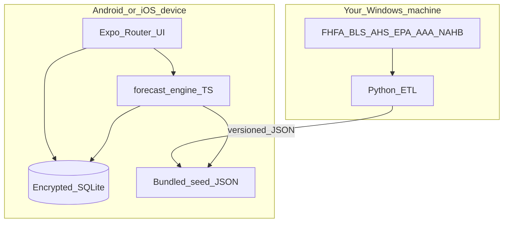

> Snapshot of the original Cursor plan (all steps, R1–R17, week sequence). Copied into this repo so it is not only under `%USERPROFILE%\.cursor\plans\`.
> The YAML todos above mean “scaffolded in code,” not “verified on a device.” Current tickets are [WORK.md](./WORK.md). Deferred work is [BACKLOG.md](./BACKLOG.md).

# Asset-Aware Finance App: Revised Plan

Greenfield app in this repository. The source thesis stays outside the repo. Decisions below replace a Next.js + FastAPI + Postgres cloud default.

## Locked decisions

- **Platforms:** Expo, iOS + Android. **Ship Android locally first** (this machine is Windows). iOS via EAS cloud when you have an Apple Developer account.
- **First user:** you only, one login, one household. US ZIP available — use ZIP-adjusted public data.
- **Privacy:** **local-first**. Balances, income, and assets live in **encrypted SQLite on device**. No required cloud account. Forecast runs on device.
- **Not a bank.** Planning/education copy only. No transfers, cards, or advice.
- **Plaid (free only):** Sandbox from the first Android build (always free, mock data) so the outlier → forecast loop is real in code. Your live banks via Plaid **Trial** (new US/CA teams after 2026-04-15): **free, 10 Production Items**, includes Transactions. Enough for one household. **Do not apply for paid Production.** If Trial is unavailable, fall back to manual + CSV; SimpleFIN (~$15/yr) only if you choose to spend. A thin cloud function holds Plaid secrets; household data still syncs into on-device SQLite.
- **Investments:** balance + expected return now. Schema ready for tickers later. No live prices in MVP.
- **Accounts:** enumerable from day one (cash, savings, brokerage, 401k/IRA, home, vehicles, other assets, mortgage, auto loan, student loan, credit card, other debt). Generic “other” type so we do not invent a new screen per object.
- **Cash flow:** monthly net income + a short expense-category list. **±20% band on variable categories only** (food, utilities, discretionary). Fixed categories stay point estimates. Do **not** auto-fill mortgage/insurance/utilities from APIs.
- **Identity for lookups:** car = year/make/model + ZIP + mileage. Home = ZIP + year built + sqft + system ages (roof/HVAC/water heater). **No VIN, no street address** in MVP.
- **Cost data:** cheapest path that is still **real and sourced**. Aggregate **free public / published** datasets. No paid RepairPal/RSMeans/1build until the product earns it.
- **Net worth over time:** full household path — income, expenses, inflation, debt balances, repair/replacement shocks, car depreciation, home value path (FHFA), investment growth at stated returns. Show **where the money goes** (contribution waterfall).
- **Onboarding:** progressive. ZIP + house + car + cash in about two minutes, first forecast immediately, then income/expenses/debts. Unknown fields are allowed and widen ranges.
- **Three-scenario standard:** every customer-facing money figure is **Liberal / Realistic / Conservative**. Default **Realistic**. Tap to compare all three; optional advanced fan. See “Scenario standard” below.
- **Marketing and pricing:** deferred. No paywall, store listing campaign, or funnel work until you have used the Realistic forecast for ~30 days. Keep the business plan’s $9–15/month as a hypothesis only. In-app copy still follows R13/R15 so we do not paint ourselves into “bank” or “exact quote” language.
- **Habit loop:** daily check of new transactions. Outlier notifications show the **Realistic** 5-year delta; the event screen also shows Conservative. Example: “$1,800 Pep Boys — Realistic net worth −$1,800.” Sandbox first, then Trial.

## Honest limit on “real” free vehicle/home data

Free data will **not** produce a shop quote for “2018 Honda Civic, this ZIP, this week.” It will produce **sourced, ZIP- and class-adjusted distributions** shown as Liberal / Realistic / Conservative (internally P25 / P50 / P75 of the relevant variable). That is still real data, not invented $15k/$2k constants. Those constants become the **demo fixture** only if they fall inside the data-derived range; otherwise the demo uses the data.

Model-specific shop estimates require paid APIs later (VehicleDatabases, Craftsman, 1build, HomeQuotr).

## Scenario standard (Liberal / Realistic / Conservative)

This is how **every** customer-facing money number is labeled. No raw “P50” or “1 in 4” on the default surface.

**Meaning (from the household’s point of view)** — confirmed: Liberal is optimistic, not “a generously high cost.”
- **Liberal** — things go well: cheaper ownership, milder expenses, stronger asset growth, **higher** net worth.
- **Realistic** — central case. **This is the default everywhere.**
- **Conservative** — things go poorly: costlier ownership, heavier variable spend, weaker growth, **lower** net worth.

**Engine mapping (coherent worlds, so line items add up)**

We do **not** take a different percentile of the joint Monte Carlo for each row (those would not sum). We run three deterministic scenario worlds, plus one Monte Carlo for the optional dive-in fan.

- Ownership costs (home/vehicle repairs, replacements): Liberal = P25 of that item’s distribution, Realistic = P50, Conservative = P75
- Variable living expenses: Liberal = −20%, Realistic = midpoint, Conservative = +20%
- Home value path: Liberal = stronger FHFA-style path (upper published band), Realistic = metro/ZIP median path, Conservative = weaker / flat-real path
- Vehicle value: Liberal = slower depreciation, Realistic = class curve, Conservative = faster depreciation
- Investment growth: Liberal = user return + 2 pp (capped), Realistic = user/default return, Conservative = user return − 2 pp (floored at 0% for cash-like)
- Inflation: used inside the engine; UI still defaults to today’s dollars (R8)

**UI rules**
- Hero and cards show **one number: Realistic**, with a small scenario control (Liberal | Realistic | Conservative).
- Changing the control retints the whole app for that session (homepage, risk, forecast, waterfall, emergency gap). No mixed scenarios on one screen.
- **Dive-in** (tap the number or “Compare scenarios”): three columns, same sources, what differs (e.g. “Conservative uses higher repair costs and slower home growth”).
- **Advanced** (inside dive-in only): Monte Carlo fan of net worth. Still labeled with the three scenario markers on the fan, not P10–P90 jargon.
- Copy: “Realistic 5-year house cost: about $X.” Dive-in subtitle: “Liberal $A · Conservative $Y.”
- Notifications and “This looks wrong” edit the Realistic world first; Conservative impact is shown on the event detail.

**Emergency fund** uses the Conservative ownership-shock total so the reserve is built for a bad year. The user can still view Liberal/Realistic targets in dive-in.

## Gaps that remain (from the original doc)

- Stack in the doc (Next.js, Recharts, cloud FastAPI, Redis, week-7 OCR) does not match this product.
- **FinAtlas is proprietary** — do not use its code.
- WorthFlow/monteplan are not dependencies.
- No ToS/disclaimer in the doc; local-first still needs an in-app “not financial advice” screen.
- Doc 8-week plan included receipts/LLM; both stay out.
- “Global USD” users later get national USD curves; your household uses US ZIP adjustment.

## Architecture (revised for local-first)

**Runtime (on phone)**
- Expo + Expo Router + TypeScript
- NativeWind
- TanStack Query against a local repository (not HTTP)
- Drizzle + **SQLCipher / op-sqlite encryption**
- Expo SecureStore for the DB key, unlocked with biometrics/PIN (`expo-local-authentication`)
- Victory Native (Skia) for net-worth fans and cost breakdown
- `packages/forecast-engine` in **TypeScript** (Monte Carlo is small enough on-device; 2k–5k paths)

**Offline ETL (on your PC, not in the app process)**
- Python 3.12 + pandas
- Downloads and normalizes public files into `data/seed/home_v1.json`, `vehicle_v1.json`, `macro_v1.json`
- Each row: value or distribution, geography key, vintage date, URL/citation, license note
- App ships the latest seed files; you bump them with EAS Update

**Cloud (Plaid only, keep it tiny):** one FastAPI (or serverless) service: `link_token`, `public_token` exchange, encrypted `access_token` storage, `/transactions/sync` webhook or poll. No household ledger in the cloud. App pulls transactions down and writes them into encrypted SQLite. Forecast still runs on device.

**Still no MVP:** Clerk, full Postgres household DB, Redis, receipts, LLM, paid Plaid Production.

**Repo**
- `apps/mobile`
- `packages/forecast-engine` (TypeScript, unit-tested)
- `packages/data-etl` (Python)
- `data/seed/*.json`

## Account and forecast model

**Net worth(t)** = liquid + investments(t) + home(t) + vehicles(t) + other assets(t) − liabilities(t)

Each month, for each Monte Carlo path:
- Income (point)
- Variable expenses × Uniform/Normal draw in **±20%**
- Fixed expenses (point)
- Scheduled debt service from **liability accounts** (balance, APR, minimum payment). Principal reduces the liability (equity rises). If the user also typed “mortgage” as an expense, link or exclude it so we do not double-count.
- Investment accounts grow at their expected return (deterministic or a simple shock later)
- Home value follows FHFA ZIP/metro HPI path (or user override %)
- Vehicle value follows a class depreciation curve × FRED used-vehicle CPI, starting from user-entered current value
- Repair/replacement events draw from seed distributions; they **reduce cash** (and net worth) when they fire
- Inflation from BLS CPI-U on long-range dollars

**Contribution waterfall** (this is the “where it costs the most” view): cash-flow and net-worth change attributed to home repairs, car maintenance, depreciation, interest, living expenses, etc.

**Emergency fund** = `max(3 months of Realistic expenses, Conservative next-12-month ownership shocks)` using **liquid accounts only**. 401k/IRA/home equity never count. The homepage can still show Liberal/Realistic/Conservative fund *targets* if the user dives in; the recommended number is Conservative.

**Liabilities are first-class** even though cash-flow entry is income + categories. That is how a mortgage makes net worth rise as you pay principal.

## Free data we will actually aggregate

All stored with citation, retrieval date, and terms. No scraping of sites that forbid it — use official downloads and published tables you are allowed to reproduce with attribution.

**Macro / net worth path**
- [FHFA House Price Index](https://www.fhfa.gov/data/hpi) — ZIP or metro home-value path
- [FRED / BLS CPI](https://fred.stlouisfed.org/) — CPI-U, used vehicles, motor-vehicle maintenance, household operations
- BLS CPI-U as default inflation

**Home repair / replacement**
- Census [American Housing Survey](https://www.census.gov/programs-surveys/ahs.html) — maintenance/repair spend by home age and region
- Published useful-life tables (ASHRAE/DOE-style HVAC, typical roof/water-heater lives) cited in seed files
- NAHB / Harvard JCHS remodeling cost publications — **manual, attributed extract** into JSON (not a live scrape)
- User system ages (roof/HVAC/WH) select which replacement curve applies

**Vehicle**
- [EPA fueleconomy.gov](https://www.fueleconomy.gov/feg/ws/) — year/make/model → class, MPG (fuel only if you add a fuel category)
- NHTSA vPIC make/model lists — class mapping only, no VIN required
- AAA *Your Driving Costs* annual tables — attributed maintenance/operating averages by class
- BLS motor-vehicle maintenance CPI — time adjustment
- Age/mileage multipliers on class averages (older / higher miles → higher maintenance distribution)

**ZIP handling:** US 5-digit ZIP → FHFA metro/ZIP and Census region. Invalid/non-US ZIP later falls back to national USD.

**Not in MVP:** Zillow live API, KBB, Edmunds TCO, RepairPal, RSMeans, 1build, HomeQuotr, ticker prices.

## Open-source tools

**Use**
- Expo, Drizzle, Victory Native, NumPy/pandas **in ETL only**
- pytest or the TS equivalent for engine property tests

**Study only**
- Actual Budget (MIT) — local-first ledger and net-worth UX
- Beancount — account types
- okama (MIT) — percentile presentation; use in ETL/research if you add portfolio math later

**Do not use**
- FinAtlas source (proprietary)
- Firefly III code in-repo (AGPL); ideas only
- Paid TCO APIs until you choose to spend

## Screens (what you will tap)

1. Unlock (PIN/biometrics)
2. Progressive onboarding: ZIP → add house → add car → add cash → **first forecast**. Then income, expenses, debts. “Not sure” on system ages.
3. **Net worth** hero + breakdown (liquid vs illiquid)
4. **Risk** per home/vehicle: Realistic cost by default; Liberal / Conservative on tap; source, vintage, override
5. **Forecast:** Realistic net-worth path by default; scenario switcher; dive-in compares all three + optional advanced fan; ownership waterfall
6. Assumptions drawer
7. Encrypted export / import (local-first backup — phone loss otherwise wipes the household)
8. Disclaimer

Demo household remains valid: $400k house, $20k car, $80k savings, plus your real income/expenses once entered.

## Build sequence

**Week 1 — App skeleton (Android)**  
EAS **development client** (not Expo Go), encrypted SQLite, PIN lock, progressive four-field onboarding, labeled Preview household, required export step.

**Week 2 — Public data ETL**  
Scripts + first `home_v1` / `vehicle_v1` / `macro_v1`. Every number cited. Bundle into the app.

**Week 3 — Ledger + net worth**  
All enumerable types, income/expenses, waterfall-ready categories, edit flows.

**Week 4 — Risk + deterministic forecast**  
Apply seed distributions to your house/car; cash and net-worth month-by-month; no double-counted debt.

**Week 5 — Monte Carlo + waterfall**  
Percentile bands, contribution breakdown, emergency fund, scenario: income drop / replace car early.

**Week 6 — Harden + Plaid sandbox**  
Export/import, disclaimers, property tests, physical Android. Custom Expo dev client (required for SQLCipher and Plaid). Wire `react-native-plaid-link-sdk` + sandbox Item. Daily job: new txns → outlier rules → forecast re-run → local notification.

**Week 7 — Your banks (free Trial only)**  
Create a new Plaid team, stay on Trial (≤10 Items). Link checking/savings/cards. Confirm one real outlier updates the projection. Stop before any paid Production application.

**Later**  
EAS iOS, ticker holdings, paid local cost APIs, optional encrypted backup, paid Plaid only if you go beyond 10 Items.

## How we handle the risks (customer-satisfaction contract)

North star: the customer should feel **faster, clearer, and more in control** after every session than before it. If a safety rule creates friction, wrap it in a win (saved, explained, reversible)—never a lecture.

**Satisfaction tests (must pass on your own household):**
- First useful number in under two minutes, without shame for skipped fields.
- Any number that looks wrong is fixable in one tap, and the forecast updates immediately.
- They can explain a result to a spouse in one sentence, with a source if asked.
- The app never yells, never double-charges them in the math, never loses the household without a fair warning they already acted on.
- Daily contact feels like a briefing, not a badge grind. They can mute it in one tap.

### 1. Onboarding wall → a short win, then optional depth

**Customer feels:** “I already got something. I can make it better when I want.”

- Four fields only (ZIP, house, car, cash), then a real forecast sentence. A progress bar says “Forecast completeness 40% — add income to tighten this.”
- Remaining steps are cards on the home screen (“Add take-home pay,” “Add mortgage”), each unlocking a visible change (“Emergency fund gap dropped $2,100”).
- Back is always safe. Nothing entered is discarded. No account required.

### 2. Unknown fields → wider range, not a scolding

**Customer feels:** “Not knowing is allowed. The app got more cautious, not stuck.”

- Primary button can be **Not sure** on roof, HVAC, mileage, even home value (then we use ZIP median from FHFA as a labeled estimate they can replace).
- Chip: “Using typical 1998 homes in your ZIP. Add roof year to narrow.”
- Tapping the chip jumps to the one field that most reduces uncertainty (information-gain order, not a long form).

### 3. Vehicle entry → search like a human types

**Customer feels:** “I typed Civic and it knew.”

- One box, debounce search, 2018 / civic / Honda all work.
- Miss: “We’ll treat this as a midsize car. Change class.” Never a dead end.

### 4. Double-counted debt → one calm question, then never again

**Customer feels:** “It caught my mistake. I didn’t have to understand double-entry.”

- Trigger only when name or amount is suspiciously similar.
- Copy: “You already have a mortgage payment of $2,100. Is **Housing $2,100** the same bill?” Buttons: Same bill / Separate / Not sure (treat as same, easy to unlink).
- After that, the payment appears once in “Where money goes.” Linked items show a small “tied to mortgage” label.

### 5. 401k burying the roof → cash story is the homepage

**Customer feels:** “This is about whether I can pay for the house and car—not a fake $2M victory.”

- Hero: **cash runway + next 12 months of likely ownership costs + gap.**
- Full net worth is a second tab titled “Including home and retirement.”
- If illiquid net worth is healthy but cash cannot cover **Conservative** shocks, the homepage says so: “On paper you’re fine. In cash you are $X short of a conservative house year.” That sentence is the product. Scenario control still applies to the hero number (default Realistic).

### 6. Scary charts → one sentence they can repeat

**Customer feels:** “I know what to remember.”

- First line is always the **Realistic** figure in today’s dollars. Liberal and Conservative are one control away, not in the headline.
- “Why this number” expands sources and vintage.
- “This looks wrong” sits on every card: edit assumption → instant recompute → “Updated. House 5-year likely cost is now $X.” No submit, no save dialog.

### 7. Data loss → backup as a save-your-work win

**Customer feels:** “I saved my household,” not “legal checkbox.”

- After first forecast: “Save a backup so a new phone doesn’t wipe this.” Primary: **Save backup**. Secondary: “Remind me tonight.”
- No typed waiver in their face. If they skip, a single evening reminder. After 14 days without a backup, a banner, not a modal.
- Restore is an obvious first-run choice: “I have a backup file.”
- PIN forgotten + no backup = household gone. We say that once, next to the Save button, in one sentence.

### 8. Stale numbers → honest, not nagging

**Customer feels:** “It told me what might be off. It didn’t punish me.”

- “Cash · 12 days ago” under the hero. After 30 days, the completeness score drops and the sentence adds “based on older cash.”
- Plaid sync success is a quiet checkmark, not a toast every time.

### 9. Daily loop → a briefing, mute in one tap

**Customer feels:** “This was worth opening,” or they never hear from us.

- Opt-in morning brief (they asked for daily). **One notification per day max.**
- If outliers: the largest one + net-worth delta + “Open to adjust the plan.”
- If none: **at most 3 ‘all clear’ mornings**, then silence until something changes. Copy: “On track. No surprises yesterday. 5-year picture unchanged.” After the third all-clear, we stop until an outlier or a stale-cash event.
- Notification settings: Daily brief / Outliers only / Off. Default: Daily brief. Changing it is one tap from the notification itself (“Less of these”).

### 10. Outlier → they teach the model in one tap

**Customer feels:** “I told it that was the water heater. It won’t warn me about that twice.”

- Actions on the event: **Expected · One-off shock · Recurring · Ignore merchant.**
- Shock: mark the modeled HVAC/roof/repair as **happened**, pull it out of future risk, drop cash, show the new forecast.
- Wrong category: fix merchant mapping once.

### 11. Preview vs real life → no contaminated totals

**Customer feels:** “That demo was a tour. These are my numbers.”

- First launch can show Preview with a persistent **Preview** badge and muted palette.
- “Start with my household” is the only way off Preview. Confirm: “This replaces the example.”
- Never mix demo assets into a real household id.

### 12. Trust in the data → vintage and humility

**Customer feels:** “They’re not pretending this is a dealer quote.”

- Every sourced figure shows origin + date.
- First house/car result includes: “This is typical for your ZIP and vehicle class, not a shop bid. Override any line.”

### 13. Technical friction → they never see Expo Go or a white screen

**Customer feels:** “I installed an app. It opened. It was fast.”

- Ship a real Android dev/preview build. Deterministic sentence in <300ms; Monte Carlo fills the range in the background (skeleton → solid). If a run takes >2s, show the last good sentence, not a blocker spinner.
- Plaid Link failure: “Bank link didn’t finish. Your manual numbers are still here.” Never empty the ledger.

### 14. Advice risk → one honest frame

**Customer feels:** “It’s on my side, not selling me a product.”

- Single first-run frame: planning estimates, not advice, not a bank. Then a small footer. No interstitial before every chart.

## Risk avoidance rules (engineering checklist)

These implement the contract above. If a screen violates one, it is a bug.

### 1. First forecast in four fields

Onboarding may ask only: **ZIP, house (value + year built), car (year/make/model + value), cash**. Then show the forecast. Income, expenses, debts, system ages, mileage come after, from the home screen as “Improve this forecast.”

- Hard cap: no more than **5 taps** to the first number.
- A completeness score (0–100) is always visible. The engine always runs; missing fields widen intervals and drop the score.
- Confidence chip examples: “Home systems unknown — using age-of-home averages.” Never a blocked form.

### 2. Every hard question has “Not sure”

Roof year, HVAC age, water-heater age, mileage, home value, and expense amounts accept **Not sure**. That substitutes a wider published distribution, not a made-up point. Do not require a number to continue.

### 3. Vehicle search, not a tree of dropdowns

Single search box against the bundled EPA/NHTSA make-model list. Type “2018 civic” → pick. If no match, allow custom name + vehicle **class** (car / SUV / truck / van) so class-level AAA/BLS costs still apply.

### 4. Debt cannot be counted twice

Liabilities own the payment schedule (balance, APR, minimum payment).

When the user adds a liability **or** an expense whose name/amount looks like housing or a car payment (amount within 10%, or tokens like mortgage / rent / honda / auto loan):

- Prompt: “Is this the same as [Mortgage $2,100]?”
- **Yes** → link them. Cash-flow uses the liability only. Expense is a label, not a second outflow.
- **No** → keep both and tag as reviewed so we do not ask again.

Engine property test: linked pairs must appear once in monthly outflows.

### 5. Two net-worth stories, default to cash safety

**Home (default):** Spendable cash + 12-month shock risk + emergency-fund gap. This is the product.

**Full (secondary tab):** Illiquid net worth including home equity and retirement growth.

Default waterfall filter: **Ownership costs only** (home + vehicles + related debt interest). A toggle reveals living expenses and investment growth. Never let a 7% 401k line bury the roof.

### 6. Realistic sentence first; Liberal / Conservative on dive-in

Every money screen opens with today’s dollars and the **Realistic** sentence:

“Realistic 5-year house cost: about $X.”

The scenario control switches that sentence to Liberal or Conservative. Dive-in lists all three. Advanced fan is opt-in only. Banned in UI copy: “exactly,” “precise,” “guaranteed,” “advice,” and raw percentile jargon (P25/P50/P75) on default surfaces. Use “about,” “Liberal,” “Realistic,” “Conservative,” “sourced from.”

### 7. Real dollars on screen, inflation only in the engine

Users see **current (real) dollars** unless they flip “show future (nominal) dollars.” The $500k snapshot and the 5-year cost must be in the same unit by default.

### 8. Backup as a save, not a gate

After the first forecast, offer **Save backup** (encrypted file). Skip is “Remind me tonight,” not a typed waiver.

- One evening reminder if they skipped; banner if last backup is older than 14 days.
- Never claim Android Auto Backup will restore the vault (SecureStore key is not in that backup).

### 9. Freshness, not fake living data

Every balance and asset shows **last edited**. Plaid-linked accounts show **last synced**.

- Manual cash older than 30 days: banner “Cash may be stale.”
- No Plaid yet: no purchase outliers. Do not invent them. Optional daily brief can only say completeness/stale-cash, and follows the 3-all-clear-then-silence rule.
- With Plaid: at most one notification per day (rule 9 in the satisfaction contract).

### 10. Outlier rules so daily is useful, not spam

A transaction notifies only if **any** of:

- Amount ≥ **$500** and ≥ **2×** that category’s typical month-to-date, or
- Merchant/category looks like home or vehicle (hardware, HVAC, dealer, parts, body shop) and amount ≥ **$200**, or
- It matches a modeled shock (roof, HVAC, brakes) within 30% of the **Realistic** event cost.

Then re-run forecast on device and show **one line of impact** (cash, category, 5-year net-worth delta). User can mark “this was the water heater” to calibrate that event as realized (removes it from future risk).

Sandbox first, then Trial (≤10 Items). No paid Plaid.

### 11. Demo is a costume, not your books

Labeled **Preview household**. “Use my numbers” wipes demo rows or copies structure with empty values. After that, demo data cannot reappear in totals. Tests must fail if demo fixtures leak into a real household id.

### 12. Dev client from commit one

Week 1 creates an **EAS development build** for Android. Do not start in Expo Go. SQLCipher and Plaid Link are native modules.

### 13. Vintage on every sourced number

Risk cards and assumption drawer show `source + vintage` (example: “AHS 2023 · FHFA 2026-Q1 · model home_v1”). If seed data is older than 18 months, show “Cost tables may be outdated.”

### 14. Disclaimer once, then stay out of the way

First forecast: one screen, “Planning estimates, not advice, not a bank.” Don’t repeat it on every tap. Keep a footer link.

### 15. What we will not build yet (so we do not dilute the above)

Spouse accounts, non-USD, tax engine, insurance shopping, buy-this-house compare, web app, LLM, receipts, paid cost APIs, paid Plaid Production.

## Usability risks — each one solved

The earlier gap list is closed below. If a row is not implemented, the milestone is not done.

**R1 Onboarding wall**
- Solved by: four-field path (ZIP, house, car, cash) then a forecast sentence. Everything else is optional “Improve this forecast” cards that show what will change.
- Done when: a new install reaches a **Realistic** house+car sentence in ≤5 taps without income, debts, or system ages, and can switch Liberal/Conservative.

**R2 “I don’t know”**
- Solved by: Not sure on roof, HVAC, water heater, mileage, and home value (FHFA ZIP median, labeled). Wider interval + completeness drop. Next-best-question chip.
- Done when: you can skip every system-age field and still get a forecast; adding roof year narrows the range.

**R3 Make/model picker**
- Solved by: one search box on bundled EPA/NHTSA names. Fallback: custom name + class so AAA/BLS class costs still apply.
- Done when: “2018 civic” yields a pick in one field; unknown model never blocks.

**R4 Double-counted debt**
- Solved by: liabilities own cash-flow. Similar name/amount prompts “same bill?” Linked expense is a label only. Property test: one outflow.
- Done when: adding Mortgage $2100 + Housing $2100 as “same” changes monthly burn once, not twice.

**R5 Investments hide the house/car**
- Solved by: homepage = cash + 12-month ownership shocks + gap. Full net worth is a second tab. Default waterfall = ownership costs only.
- Done when: a $200k 401k at 7% does not dominate the first screen; the roof still leads.

**R6 Retirement counted as repair cash**
- Solved by: emergency fund and “can you pay HVAC” use checking/savings/cash only. Copy if illiquid looks fine but cash does not.
- Done when: emptying checking with a fat 401k still shows a cash shortfall, not “you’re covered.”

**R7 Fan-chart literacy / three-scenario standard**
- Solved by: Liberal / Realistic / Conservative on every money figure. Default Realistic sentence. Compare-all dive-in. Advanced Monte Carlo fan only inside dive-in, marked with the three scenarios (no P-jargon).
- Done when: homepage, risk cards, forecast, waterfall, emergency fund, and an outlier event all share the same scenario control; a Forecast screenshot makes sense with no chart.

**R8 Nominal vs real dollars**
- Solved by: UI default is current dollars. Nominal is an explicit toggle.
- Done when: 5-year house cost and the $500k snapshot are in the same unit unless the toggle is on.

**R9 Stale household / one-time calculator**
- Solved by: last-edited on every balance; 30-day stale banner; Plaid outliers mark shocks realized; completeness falls if cash is old.
- Done when: aging cash by 31 days in a test changes copy and score; marking “that was the water heater” removes that event from future risk.

**R10 Local-first data loss**
- Solved by: Save backup after first forecast (encrypted file). Skip → remind tonight. 14-day banner. First-run “I have a backup.” Never claim Android Auto Backup restores the vault.
- Done when: export → wipe app → import restores the same household and the same forecast seed.

**R11 Expo Go / native modules**
- Solved by: EAS Android development build in week 1. SQLCipher + Plaid Link only on that client.
- Done when: `npx expo start` in Go is not the documented run path; README says the dev client.

**R12 Demo contaminates real books**
- Solved by: Preview household, badge + muted theme, “Start with my household” replaces it. Tests fail if demo rows appear on a real household id.
- Done when: after “use my numbers,” totals cannot include the $400k example house unless you typed it.

**R13 “Budgeting app” with no register**
- Solved by: do not sell month-to-month budgeting until Plaid. Until then it is a planner. With Plaid (sandbox then free Trial): daily digest of outliers, not a full YNAB register in MVP.
- Done when: store/listing/disclaimer copy says planning + ownership costs; no “track every coffee” claim.

**R14 Stale public cost tables**
- Solved by: source + vintage on every sourced figure; banner if seed older than 18 months.
- Done when: house risk card shows e.g. “AHS 2023 · FHFA 2026-Q1 · home_v1”.

**R15 Fake precision / “exactly”**
- Solved by: banned words (exactly, guaranteed, advice). Ranked ranges and % of net-worth change. Honest ZIP/class disclaimer on first asset result.
- Done when: grep of UI strings has no banned words; first house card includes the shop-bid disclaimer.

**R16 Daily reminders become spam**
- Solved by: opt-in brief, hard cap one notification/day. Outlier → impact line. All-clear ≤3 times, then silence until something changes. “Less of these” on the notification. No fake purchase alerts without Plaid.
- Done when: 10 quiet sandbox days produce ≤3 all-clears and never more than one notify per calendar day.

**R17 Plaid cost**
- Solved by: sandbox in the first build; live banks only on free Trial (≤10 Items). No paid Production. Fail Link without wiping the ledger.
- Done when: sandbox outlier updates the on-device forecast; README forbids applying to paid Production.

**Explicitly not solved (out of scope, not forgotten):** spouse login, non-USD, tax engine, insurance shopping, buy-this-house compare, web companion, LLM, receipts, paid TCO APIs.

## Remaining worries (not blockers)

These are still true. They do not reopen R1–R17. They do mean we should not add marketing or pricing work now.

- **Scope vs one builder.** Local vault, public-data ETL, L/R/C engine, and a Plaid stub is a lot. If weeks slip, cut order is: Plaid sandbox last, Monte Carlo fan last, full account-type polish last. Do not cut the four-field forecast or Realistic default.
- **Class-level cost data will look “wrong” sometimes.** AHS/AAA are real but not your contractor. “This looks wrong” is the safety valve. First-week trust depends on that, not on buying RSMeans.
- **This machine had no Python when we read the business plan.** ETL needs a one-time Python 3.12 install on Windows, or we generate the first seed JSON by hand and automate later.
- **FHFA is not every ZIP.** Fall back to metro, then national, and label it. Never silent.
- **Plaid Trial is for you, not a public launch.** 10 free Items is enough for one household. A store launch would force paid Plaid and a real privacy policy. That is a later company problem.
- **Local-first plus a tiny Plaid server is a seam.** Tokens in the cloud, books on the phone. If that is painful, stay manual/CSV until you care about outliers.
- **You are the only customer.** The original plan’s 10–20 interview gate never happened. The product risk is building a perfect tool for one household. Using it for 30 days is the research.

## Marketing and pricing — too early

Do **not** define a campaign, content calendar, or paywall before the app produces a Realistic forecast you believe.

The business plan already has a thesis: $9–15/month, lead with “what will the house cost me,” not “another budget app.” That is enough to remember. Reasons to wait:

- There is nothing to market except a document. Screenshots and a forecast you trust are the first assets.
- Local-first has no user account, so Stripe/subscriptions would force a cloud identity you explicitly deferred.
- Paid Plaid, paid cost APIs, and CAC only make sense after willingness-to-pay is real.
- Wrong GTM now (calling it a bank, or “exact repair quotes”) creates legal and trust debt.

**Revisit when:** you have used your own ZIP household for ~30 days, you have marked at least one real shock or override, and preferably 3–5 other people complete a forecast without you in the room. Then write a one-page: who it’s for, the one sentence, price test ($0 vs $9 vs $12), and where to find the first 20 users (homebuyer / car-buyer communities from the doc).

Until then, the only “marketing” rule is product copy: planning, not banking; ranges, not quotes; Realistic default.

## Success bar (solo first)

- Your real ZIP household produces a 5-year net-worth fan that you can explain line by line from sources
- Changing roof age or mileage moves the forecast in the right direction
- Export, wipe app, import — same net worth and same forecast seed
- No financial data leaves the device
- R1–R17 done-when checks pass on a physical Android build
- First useful forecast is reachable without filling every field
- Emergency-fund recommendation uses liquid cash only
